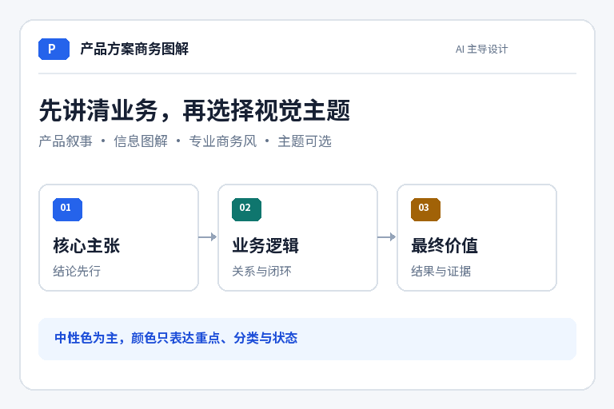

# ProductNarrative AI

> AI 产品方案与商务图解：先讲清业务，再选择视觉主题。



**ProductNarrative AI** 是一个面向中文产品方案、产品概念与管理层汇报的技能。它帮助 AI 完成从资料理解、叙事设计、信息图解、商务主题选择到最终 PDF 评审的完整过程，而不是机械套用模板或执行固定脚本。

仓库名称为 `product-narrative-ai`，内部技能标识为 `product-solution-brief`。

## 核心特点

- **AI 主导设计**：由 AI 判断受众、汇报目标、内容骨架、图形形式和制作方式。
- **结论先行**：围绕“为什么做、如何成立、谁来负责、怎样使用、创造什么价值”组织内容。
- **商务主题可选**：不固定红色或蓝色，根据行业、品牌、受众与使用场景自主选择专业配色。
- **图解服务内容**：关系、闭环、职责、流程、对比与案例分别采用合适的图形，不为每页强套流程图。
- **制作路线开放**：支持原生排版、矢量绘图、演示文稿、PDF 和图像工具，脚本仅作可选辅助。
- **重视最终评审**：检查业务事实、中文文字、图标居中、表格对齐、跨页一致性和最终 PDF 完整性。

## 适用场景

适合用于：

- 产品概念与产品方案汇报
- 管理层、投资人或客户决策材料
- 产品闭环、用户旅程与角色职责说明
- AI 产品的能力边界与责任分工说明
- 竞品能力映射与产品差异化表达
- 复杂业务方案的图解型 PDF

不适用于：

- 详细技术实现架构与接口设计
- 财务模型或数据建模
- 普通文字润色
- 只需单张海报或营销长图的任务

## 安装

### 方式一：放入技能目录

将完整的 `product-solution-brief` 目录复制到当前 Agent 使用的技能目录，并确保该环境能够发现 `SKILL.md`。

### 方式二：打包为 `.skill`

在包含本目录的上一级路径执行：

```bash
zip -r product-solution-brief.skill product-solution-brief \
  -x '*/__pycache__/*' '*.DS_Store'
```

随后通过支持 `.skill` 文件的客户端导入安装包。

## 使用示例

### 生成完整产品方案

```text
使用 product-solution-brief，根据当前项目资料制作一份管理层产品方案 PDF。
先判断受众与核心主张，再设计叙事和页面图解。
视觉采用专业克制的商务风，主题由你根据内容自主选择。
```

### 指定品牌色

```text
使用 product-solution-brief 制作产品概念汇报。
保留企业品牌蓝作为主色，以白色和中性灰为主，辅助色只用于分类与状态。
先讲产品整体逻辑，再用一个连贯案例说明用户如何达到结果。
```

### 只要内容骨架

```text
使用 product-solution-brief 的叙事方法，先输出产品方案大纲。
每页给出结论标题、需要回答的问题和建议主视觉，暂不制作 PDF。
```

### 评审现有方案

```text
使用 product-solution-brief 评审这份产品方案。
重点检查叙事是否结论先行、颜色是否喧宾夺主、图形是否准确表达业务关系，以及后半部分是否比前半部分更花。
```

## AI 工作流

1. **判断任务**：识别受众、汇报目的、使用场景与期望动作。
2. **整理事实**：区分已确认事实、目标设计、示例数据与待确认问题。
3. **设计叙事**：先确定核心主张，再安排页面顺序，每页只表达一个结论。
4. **选择主题**：定义画布、表面、主色、正文、辅助色、语义色、字体与空间规则。
5. **选择图形**：根据信息关系选择关系图、闭环图、状态图、表格或案例故事板。
6. **制作与评审**：先检查封面、复杂图解页和密集信息页，再完成整套。
7. **检查交付文件**：重新打开最终 PDF，核对页序、比例、清晰度、文字与图形。

## 商务视觉原则

商务风不等于单调，也不等于所有页面使用同一种颜色。颜色必须承担明确职责。

| 视觉角色 | 使用原则 |
| --- | --- |
| 画布与表面 | 白色或中性色承担主要面积，保证投影与阅读对比 |
| 主色 | 用于品牌、当前重点和关键路径，避免铺满所有模块 |
| 正文 | 使用高对比深色，说明文字采用可读的中性灰 |
| 辅助色 | 通常 1–2 种，只用于稳定分类或角色区分 |
| 语义色 | 成功、警告、风险按语义使用，不作普通装饰 |
| 线条与形状 | 平面、细线、适度圆角，图标保持视觉居中 |

应避免：

- 彩虹式卡片循环与连续彩色标题
- 用大面积艳色、边框和装饰抢走内容注意力
- 为了塞入内容不断缩小字体
- 无意义流程节点、炫光、3D 机器人和假控件
- 把 AI 建议、用户确认、平台执行与业务结果混为一谈

## 目录结构

```text
product-solution-brief/
├── SKILL.md                         # 技能入口与 AI 工作流
├── agents/
│   └── openai.yaml                  # 技能展示名称与默认提示词
├── assets/
│   └── preview.png                  # 项目预览图
├── references/
│   ├── narrative-and-layout.md      # 叙事、主题与专业感评审规则
│   ├── page-brief.md                # 单页设计简报与制作指令骨架
│   ├── layout-map.jpg               # 参考稿版式缩略图
│   └── reference.pdf                # 可选叙事与版式参考
└── scripts/
    ├── reference_pages.py           # 可选：提取参考 PDF 页面
    └── assemble_pdf.py              # 可选：按顺序合成页图 PDF
```

参考 PDF 只用于学习叙事与版式，不是唯一视觉基准，也不继承其中的品牌、案例、配色或业务能力。

## 可选脚本

脚本不是技能的固定入口。只有需要对应操作时才使用。

运行脚本需要 Python 与 PyMuPDF：

```bash
python -m pip install PyMuPDF
```

提取参考页：

```bash
python scripts/reference_pages.py \
  --pages 1,3,4,5,14 \
  --output-dir /absolute/path/reference-pages
```

将同比例页图合成为 PDF：

```bash
python scripts/assemble_pdf.py \
  --output /absolute/path/product-solution.pdf \
  /absolute/path/page-01.png \
  /absolute/path/page-02.png
```

默认不覆盖已有文件。需要覆盖合成结果时，明确添加 `--overwrite`。

## 交付质量标准

完成前至少确认：

- 每页标题是结论，且一页只有一个焦点
- 图形准确表达对象、方向、职责与状态
- 中文、数字、日期、箭头与案例条件前后一致
- 没有缺字、截断、重叠、异常换行或图标偏心
- 主色统一，辅助色有职责，风险色只用于风险
- 最终 PDF 的页数、页序、比例和清晰度正确
- 未将整页位图声称为可编辑源文件

## 贡献

欢迎提交针对叙事方法、商务视觉规则、单页简报和质量评审的改进。提交前请检查资源引用、脚本语法与技能结构，避免加入与技能无关的制作日志或临时文件。
